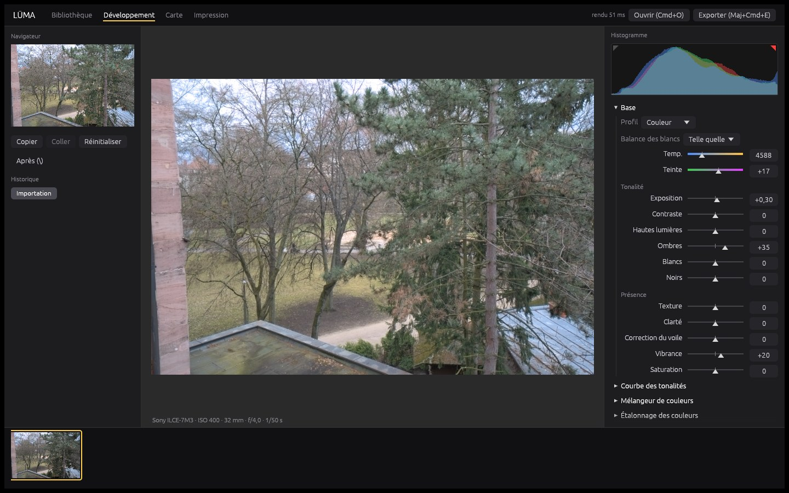

# LÜMA

**La lumière, développée en Rust.** Un éditeur photo professionnel écrit en Rust : RAW,
couleur 32 bits flottants, masques, IA locale, photothèque. **macOS et iOS/iPadOS d'abord**,
puis Windows, Linux et Android sur le même moteur.

- [Architecture](docs/architecture.md) : couches, workspace Cargo, pipeline non destructif, règles « 100 % Rust »
- [Feuille de route](docs/roadmap.md) : phases M0 → M36, Apple d'abord, jalons et risques
- [Fonctions](docs/fonctions.md) : chaque fonction, faite ou à faire
- [Site vitrine](site/) : animations, scènes 3D (objectif photo, Mac et iPhone), labo de retouche sur GPU

## Le moteur

Le moteur de développement est en Rust, sans aucune bibliothèque native (vérifié par
`scripts/audit-rust.sh`). Il offre un module Développement complet, panneau par panneau,
et enregistre les réglages dans un fichier XMP à côté de la photo.

| Crate | Rôle |
|---|---|
| `luma-core` | Images `f32`, flous rapides, filtre guidé, annulation, mesures |
| `luma-color` | Matrices, espaces (sRGB, Display P3, Rec. 2020, ProPhoto), température DNG, OKLab, profils ICC |
| `luma-raw` | Lecture des RAW (rawler), normalisation, couleur DNG, dématriçage Bayer et X‑Trans |
| `luma-project` | Les réglages non destructifs, JSON et XMP `crs:` |
| `luma-image` | Le développement : tonalité locale, rendu filmique, courbes, couleur, LUT 3D, détail, effets, géométrie |
| `luma-library` | La photothèque : catalogue local (date de prise de vue, boîtier, objectif, ISO, note, mots‑clés), mis à jour sans relire ce qui n'a pas changé |
| `luma-render` | Une photo ouverte : sources et « bases » (étapes de voisinage, celle de la photo et celles des films de masques) en cache, rendu annulable |
| `luma-merge` | Empilements, panoramas (coins, RANSAC, projections, fondus), DNG ; mesure d'une vraie pellicule en LUT 3D |
| `luma-gpu` | Les étapes par pixel (rendu, couleur, LUT 3D, effets, encodage) en WGSL sur wgpu : Metal, Vulkan ; comparées au processeur à chaque test, les 100 films compris |
| `luma-brand` | La marque, dessinée par le code : le logo (anneau de lumière en croissant et « LÜMA »), les icônes du Mac, de l'iPhone, de l'iPad et du site, le fond « éclipse » de l'app |
| `luma-licence` | LÜMA Premium : 14 jours d'essai, abonnements au mois et à l'an, clés de licence (voir [docs/premium.md](docs/premium.md)) |
| `luma-cli` | `luma` : info, développement et export, XMP, mesures, fusion, mesure d'une pellicule |

```sh
cargo build --release
target/release/luma info photo.ARW
target/release/luma develop photo.ARW -o photo.jpg --space p3 --set exposure=+0.5 --set shadows=40
target/release/luma develop photo.CR3 --size 2048 -o apercu.jpg    # lit photo.xmp s'il existe
target/release/luma xmp photo.NEF --set clarity=20 -o photo.xmp      # réglages au format XMP
target/release/luma bench photo.RAF                                   # réactivité mesurée
target/release/luma merge ciel_*.ARW --stack stars                     # empilement d'étoiles → DNG
target/release/luma merge pano_*.CR3 --pano cylindrical --no-crop      # panorama sans rognage
target/release/luma film-lut photo.ARW scan.tif -o MaPortra.cube       # mesure une vraie pellicule
target/release/luma develop photo.ARW --lut MaPortra.cube:80 -o p.jpg   # ce film, à 80 %
target/release/luma catalog ~/Photos --list                             # la photothèque, par date de prise de vue
target/release/luma presets ~/Desktop                                   # les 100 films en préréglages XMP
```

### Vérifier

```sh
scripts/fetch-corpus.sh          # 5 vrais RAW : Sony, Canon, Nikon, Fujifilm X-Trans, iPhone ProRAW
cargo fmt --all --check
cargo clippy --workspace --all-targets -- -D warnings
cargo test --workspace           # tests unitaires + développement de tout le corpus
scripts/audit-rust.sh
target/release/luma cameras --markdown --corpus tests/raw-corpus | diff - docs/boitiers.md   # matrice des boîtiers
```

Boîtiers pris en charge : [docs/boitiers.md](docs/boitiers.md). Fidélité des couleurs d'un
boîtier : `luma colorchecker photo.RAW` sur la photo d'une charte ColorChecker recadrée.

### Réactivité mesurée

Aperçu de 2048 px, développement + encodage Display P3, 15 rendus successifs comme un
curseur qu'on fait glisser. Machine de développement : 4 cœurs, sans GPU (le rendu Metal
viendra ensuite). Ce ne sont pas encore des mesures sur Mac ni sur iPhone.

| Boîtier | Premier aperçu | Réglages de base, P50 / P95 | Réglages lourds, P50 / P95 |
|---|---|---|---|
| Sony A7 III (ARW) | 166 ms | 110 / 126 ms | 247 / 270 ms |
| Canon EOS R5 (CR3) | 195 ms | 106 / 118 ms | 268 / 300 ms |
| Nikon Z 6 (NEF) | 157 ms | 102 / 113 ms | 230 / 242 ms |
| Fujifilm X‑T3 (RAF, X‑Trans) | 198 ms | 101 / 109 ms | 246 / 260 ms |
| iPhone 12 Pro (ProRAW) | 319 ms | 168 / 184 ms | 365 / 380 ms |

**Sur le GPU.** Pendant qu'on règle le contraste, les courbes, les couleurs, l'étalonnage
ou les effets, la base (bruit, tonalité locale) reste en cache et seule la finition est
refaite, sur le GPU dans l'app : le résultat est identique à celui du processeur (au plus
un niveau d'écart sur 255, vérifié à chaque push sur Metal et sur Vulkan). La CI macOS
publie le temps de finition mesuré sur Metal ; l'app affiche « GPU » à côté du temps de
rendu. `LUMA_GPU=0` force le processeur.

Finition d'un aperçu 2048 px quand on règle une couleur ou le contraste, mesurée par la
CI sur un Mac Apple Silicon de GitHub (GPU virtualisé) :

| Boîtier | Processeur | GPU (Metal) |
|---|---|---|
| Sony A7 III (ARW) | 130 ms | 8,4 ms |
| Canon EOS R5 (CR3) | 151 ms | 7,7 ms |
| Nikon Z 6 (NEF) | 100 ms | 7,0 ms |
| Fujifilm X‑T3 (RAF) | 104 ms | 7,2 ms |
| iPhone 12 Pro (ProRAW) | 228 ms | 9,4 ms |

« Lourds » : Hautes lumières, Ombres, Clarté, Texture, Voile, Vibrance, mélangeur,
étalonnage, réduction du bruit, vignetage, tous actifs. L'objectif est un aperçu sous
100 ms (P95) sur Mac Apple Silicon ; la CI publie ces mesures à chaque push.

## LÜMA Studio, l'app Mac



`apps/studio` : l'application, en Rust (egui, rendu wgpu sur Metal). Une interface qui
ne ressemble à aucune autre : la photo occupe tout l'écran, les outils flottent dessus
dans des îlots de verre fumé, et l'anneau spectral de LÜMA marque l'outil actif.

- **Rail des outils** : Bibliothèque (grille, notes, drapeaux, filtre), Lumière
  (profil, balance des blancs, tonalité, courbe, historique), Couleur (mélangeur,
  étalonnage, calibration), Détail (netteté, bruit, vignetage, grain), Masques (radial
  ⭕, linéaire ☰, pinceau), Films (pellicules et looks avec aperçu sur la photo et
  intensité), Géométrie (recadrage, objectif, perspective), Fusion.
- **Fusion** : choisir les photos dans le film (⌘‑clic, Maj‑clic), puis
  - *Empilement* : moyenne (moins de bruit), médiane (ce qui bouge disparaît), maximum
    (filé d'étoiles, traînées lumineuses), **étoiles** (alignement sur le ciel qui
    tourne, rejet des satellites et avions) ;
  - *Panorama* : perspective, cylindrique ou sphérique, exposition compensée, fondu.
  Le résultat est un **DNG** (un vrai RAW) ; le **rognage automatique** est proposé
  comme un recadrage ordinaire, qu'on garde, modifie ou retire.
- **Films** : 100 looks, avec leur aperçu sur la photo et une intensité réglable.
  *Pellicules couleur* (Portra 160/400/800, Ektar, Gold, ColorPlus, UltraMax,
  Fujicolor C200, Superia, Pro 400H, Velvia, Provia, Astia, Kodachrome, Ektachrome,
  Agfa, Lomography…), *Cinéma* (CineStill 800T, 400D, 50D ; Kodak Vision3 50D, 250D,
  200T, 500T ; Vision2 500T ; Eastman 5247 et 5254 ; tirages Kodak 2383 et 2393,
  Fuji 3513 ; Eterna ; Reala 500D ; Technicolor 2 et 3 bandes ; blanchiment sauté ;
  rétention d'argent ; traitement croisé ; nuit américaine ; Super 8…),
  *Noir et blanc* (Tri‑X, T‑Max, HP5, FP4, Delta, Pan F, Acros, Neopan, Double‑X,
  Fomapan, infrarouge), *Instantanés et vintage* (Polaroid, Instax, jetable, Lomo,
  Holga, pellicule périmée, sépia, cyanotype, daguerréotype) et *Créatifs*. Chaque
  émulsion a sa signature (croisement des couches, mélange noir et blanc spectral :
  l'orthochromatique ne voit pas le rouge, le Retro 80S assombrit le bleu). Les 100 films
  sont vérifiés par la machine à chaque test : rendus sur une mire et mesurés en OKLab,
  chacun se distingue du rendu neutre et de tous les autres, aucun n'écrase l'image ; la
  planche‑contact est publiée par la CI.
- **Mes pellicules** : le rendu *exact* d'une vraie pellicule. On photographie la même
  scène en numérique et sur film, on choisit le scan : LÜMA aligne les deux images et
  mesure le film couleur par couleur, en LUT 3D (`.cube`). On peut aussi importer
  n'importe quelle LUT `.cube`. Ces films s'utilisent comme les
  autres : intensité, aperçu, masques, GPU, export.
- **Mes préréglages** : « Enregistrer » garde le look des réglages actuels (sans
  l'exposition, la balance ni le recadrage) ; « Importer » accepte les préréglages
  XMP (`.xmp`). **Export** en préréglages XMP : clic droit
  sur un film pour l'exporter seul, ou « Exporter tous les préréglages » pour un dossier
  rangé par famille (les pellicules mesurées emportent leur `.cube`).
- **LÜMA Premium** : 14 jours d'essai, puis un abonnement à 19,99 € par mois ou
  239,88 € par an ; la puce de la barre du haut ouvre l'écran Premium (formules, clé de
  licence). Paiement par Stripe, clé signée vérifiée hors ligne : [docs/premium.md](docs/premium.md).
- **Télécharger** : sur le site (section Tarifs) et dans les Releases GitHub (app Mac
  universelle, app iPhone et iPad non signée, ligne de commande Mac et Linux).
- **Une app qui ne ressemble à aucune autre** : le logo de LÜMA (l'anneau de lumière)
  dans la barre, à l'accueil et comme icône ; le fond « éclipse », un noir profond
  éclairé par les lueurs du logo (or en bas à gauche, bleu en haut à droite) et un
  immense anneau en filigrane, sous des îlots de verre fumé.
- **Photo modifiée, d'un coup d'œil** : sous la photo, une étiquette dit son film, son
  intensité et ce qui a été retouché (« Portra 400 · 80 % — Lumière, 1 masque ») ; sur
  les vignettes du film et de la grille, un point spectral et le nom du film.
- **Films empilés par masques** : chaque masque (radial, linéaire, pinceau, ou « Image
  entière ») peut porter son propre film avec son intensité ; les films s'empilent dans
  l'ordre des masques, chacun dans sa zone, *complets* : leurs hautes lumières, ombres
  et clarté agissent aussi localement (chaque film a sa base de développement, gardée en
  cache). Sur le GPU comme à l'export.
- Les réglages sont enregistrés automatiquement dans un fichier XMP à côté
  du RAW, qui n'est jamais modifié.

| Raccourci | Action |
|---|---|
| `\` | Avant / après |
| Cmd+Z, Maj+Cmd+Z | Annuler, rétablir (chaque geste est une étape d'historique) |
| Maj+Cmd+C, Maj+Cmd+V | Copier, coller les réglages |
| Maj+Cmd+R | Réinitialiser |
| Maj+Cmd+E | Exporter : la photo ou toutes celles du filtre ; JPEG, PNG ou TIFF 8/16 bits ; sRGB, Display P3, Rec. 2020 ou ProPhoto ; taille ; dossier |
| G, D | Bibliothèque, Développement |
| 0 à 5 ; P, X, U | Note ; retenir, rejeter, retirer le drapeau (enregistrés dans le XMP, `xmp:Rating`) |
| R | Outil Recadrage : poignées, grille des tiers, proportions verrouillées ; Entrée valide, Échap annule |
| W | Pipette de balance des blancs (cliquer un gris) ; le menu Balance propose aussi Auto et des préréglages (lumière du jour, nuageux, tungstène…) |
| M, Maj+M, K | Masque : dégradé linéaire, dégradé radial, pinceau (Option gomme) ; O montre la zone ; chaque masque a ses curseurs |
| Cmd+O | Ouvrir un RAW (son dossier remplit le film) ; on peut aussi le déposer |
| ← → | Photo précédente, suivante |
| Z, J | Zoom 1:1, écrêtage |
| Double‑clic sur un curseur | Valeur par défaut ; Maj en glissant : réglage fin |

```sh
cargo run --release -p luma-studio -- ~/Photos/2026-10      # un dossier ou un RAW
scripts/bundle-macos.sh                                     # sur Mac : target/macos/LÜMA.app
```

La CI (`.github/workflows/macos.yml`) compile et teste l'app sur Apple Silicon et publie
`LUMA-macos.zip` (universelle, Apple Silicon et Intel) en artefact à chaque push. L'app
est signée « ad hoc » : au premier lancement, clic droit → Ouvrir. Un test rend toute
l'interface sans écran avec un vrai RAW et vérifie que chaque contrôle a un nom pour
VoiceOver.

## Sur iPhone et iPad

La même app, compilée pour iOS (`scripts/bundle-ios.sh sim|device`) : sur un écran étroit,
la photo occupe le haut et les panneaux le bas. Les RAW arrivent par l'app Fichiers (Sur
mon iPhone › LÜMA) ; l'app s'ouvre sur ce dossier. La CI lance l'app dans le simulateur
iOS avec de vrais RAW et publie sa capture d'écran. Pour un iPhone réel, l'app doit être
signée avec un compte développeur Apple.

## Le site

Le site est une app [Paquets](https://github.com/maxlestage/Paquets) : du Rust de bout en bout.

| Partie | Où | En quoi |
|---|---|---|
| Serveur, pages, SEO, CSP, PWA, export statique | `site/src/server/` | Rust (Paquets, natif) |
| Photo du pipeline, générée en SVG | `site/src/server/photo.rs` | Rust |
| Îlots : labo (réglages, préréglages) et filtre des crates | `site/src/islands.rs` | Rust, rendu serveur puis hydraté en WebAssembly |
| Animations de page : préchargement, révélations, curseur, inclinaison, compteurs, manifeste, pipeline 3D, feuille de route, terminal | `site/src/client/motion.rs` | Rust → WebAssembly |
| Rendu du labo (WebGL) | `site/src/client/lab.rs`, `lab.frag` | Rust → WebAssembly, shader GLSL |
| Textes et données | `site/src/content.rs` | Rust, partagé serveur/navigateur |
| Scènes 3D : objectif photo, MacBook et iPhone | `site/public/js/` | three.js r170, embarqué (aucun CDN) |
| Styles | `site/public/site.css` | CSS |

La page est du HTML fini rendu par le serveur : elle se lit sans JavaScript, avec ses
balises SEO, et sa Content-Security-Policy n'autorise que son propre code.

### Construire et lancer

Tout se lance depuis `site/` :

```sh
# 1. Le bundle du navigateur (îlots + animations) → pkg/
rustup target add wasm32-unknown-unknown
cargo install wasm-bindgen-cli --version 0.2.129
cargo build --lib --target wasm32-unknown-unknown --profile wasm-release
wasm-bindgen --target web --no-typescript --out-dir pkg \
  target/wasm32-unknown-unknown/wasm-release/luma_site.wasm

# 2. Le serveur, sur http://localhost:3000 (PORT sur Heroku)
cargo run --release

# Ou le site en fichiers statiques (GitHub Pages…), liens sous BASE_PATH
BASE_PATH=/LUMA cargo run --release -- export dist
```

Paquets et ses paquets sont des dépôts git privés : il faut un accès GitHub qui peut les lire.

### Vérifier

```sh
cargo fmt --check
cargo clippy --all-targets -- -D warnings
cargo clippy --lib --target wasm32-unknown-unknown -- -D warnings
cargo test
```

### Déployer

Le dépôt peut être privé : le site ne renvoie jamais vers GitHub. La documentation
(`docs/*.md`, `CHANGELOG.md`) est servie par le site (`/docs/…`, `/nouveautes/`), et
l'app à télécharger est récupérée dans la dernière Release au moment du déploiement.

**Heroku, buildpack `emk/rust`** (la voie principale) :

1. Créer l'app et choisir le buildpack :
   ```sh
   heroku create luma-site
   heroku buildpacks:set emk/rust -a luma-site
   ```
2. Créer un jeton GitHub *fine-grained*, en lecture seule (Contents : Read) sur les
   dépôts LUMA, Paquets, Vitesse, Securite, Memoire et Active, puis :
   ```sh
   heroku config:set REPOS_TOKEN=github_pat_… -a luma-site
   heroku config:set SITE_URL=https://luma-site.herokuapp.com -a luma-site   # ou votre domaine
   ```
   Une fois la boutique ouverte (voir [docs/premium.md](docs/premium.md)) :
   `heroku config:set LUMA_CHECKOUT_MONTHLY=… LUMA_CHECKOUT_ANNUAL=… -a luma-site`.
3. Déployer : `git push heroku master:main`, ou automatiquement par GitHub Actions
   (`.github/workflows/deploy-heroku.yml`) avec les secrets du dépôt `HEROKU_API_KEY`
   (`heroku authorizations:create`) et `HEROKU_APP` (`luma-site`). Il déploie à chaque
   push sur `master` qui touche le site, et après chaque Release (nouvelle app à
   télécharger).

Le buildpack installe Rust (`RustConfig`), puis `heroku-build.sh` construit le serveur,
les îlots WebAssembly, et télécharge `LUMA-macos.zip` de la dernière Release dans
`site/public/download/` ; le `Procfile` lance le serveur. Domaine personnalisé :
`heroku domains:add luma.app -a luma-site`.

**Autres voies** : Docker (`docker build --build-arg REPOS_TOKEN=… -t luma .`, ou
`heroku.yml` sur la stack container) ; GitHub Pages (`pages.yml`), qui ne publie que si
le dépôt est public (Pages sur un dépôt privé demande un compte payant).

**Dépôt privé et CI** : sur un dépôt privé, les minutes macOS de GitHub Actions comptent
dix fois. La CI macOS (app, simulateur iOS) ne tourne donc que sur `master`, les pull
requests et à la demande ; le moteur (Linux) vérifie chaque push.

### Apple d'abord

Pensé d'abord pour Safari sur Mac, iPhone et iPad : installable sur l'écran d'accueil (PWA,
icônes, `apple-touch-icon`), `100svh`, zones sûres (`env(safe-area-inset-*)`), densité de
pixels plafonnée à 2, moins de particules sur téléphone, rendu à la demande pour la scène
des appareils, et respect de « Réduire les animations ».
